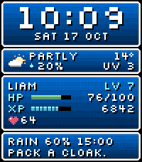
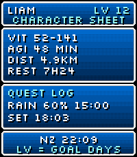

# Quest

A standalone Pebble Time 2 watchface: your day as a pixel RPG status screen.
App version 1.0.1. Emery only, 200×228, minute updates, no animation.

[Install from the Pebble store](https://apps.repebble.com/4b8887048b0f4b89a07ed816).




## Build and install

```sh
git submodule update --init shared-kit
npm ci
pebble build
pebble install --emulator emery
# With the paired phone connection available:
pebble install --cloudpebble
```

Output: `build/pebble-quest.pbw`. The project has its own UUID and no runtime
coupling to another watchface. It uses the same shared-kit dependency and
source symlinks as Mondrian and Underground. See [KIT.md](KIT.md) for its pinned shared kit 2.1.1 dependency.
Normal builds record the dependency revision and modified status in
`build/kit-build.json`; release checks are unchanged.

## Face and character sheet

The original clock window is pixel-identical to the Watchface Lab prototype.
The four main windows retain their original dimensions, dithered blue ramps,
white/grey stepped frames, pixel time and HP/XP gauges. Readability changes
use Silkscreen 16 for weather, HP/XP labels, status chips and dialogue; concise
copy replaces tiny text. NZ and the next sun event are on the character sheet.

Main LV retains the original XP formula: 1 + ten times steps/goal, capped at 99.
HP is battery out of 100; XP is steps toward the configured goal. SILENCE means
the phone is disconnected, REGEN means charging, HASTE means BPM at least 110.
Only the highest-priority chip appears, in that order. Low battery is red/amber
in HP; the urgent inn advice appears below 10% when not charging.

Tap the screen or flick the wrist to toggle the sheet. It returns after eight
seconds. VIT is today's recorded-minute BPM range, AGI is active minutes,
DIST is kilometres, REST is last night's sleep. `*` means the heart-rate
history is loading or incomplete. Sheet LV is the number of goal days in the
available 28-day history (including today when complete); its caption makes
that meaning explicit. Missing values use `--`; unavailable days are not
invented. A zero accessible steps total is a valid reading.

The quest log uses the rolling forecast across midnight. `+1` means tomorrow;
`00H+1` is tomorrow at midnight when a compact forecast clock needs the space.
A/P suffixes mean AM/PM in 12-hour event/world clocks. After sunset the sheet
uses tomorrow's sunrise; absent polar sun events show `SUN --`.

## Settings and live data

Clay settings: time format (watch/12/24), Celsius/Fahrenheit, goal (default
8,000), second zone (NZ/UTC/LON/NYC/LA/TKY/SYD), weather, optional health demo
fallback (off by default), and Hero name. Names accept eight ASCII letters,
numbers or spaces; unsupported characters are removed, letters capitalized,
and blank names fall back to LIAM. Changes apply live and persist.

Health, recorded-minute HR history, weather schedule/cache/watchdog/retries,
DST presets, settings transport and touch lifecycle come from shared-kit.
Weather is provided by [Open-Meteo](https://open-meteo.com/). The watch schedules
30-minute refreshes; data expires together after three hours. Phone sends are
serialized and failures retry after 1/5/15 minutes. No seconds subscription or
continuous drawing timer is used. Health events do not redraw the face.

## Validation

```sh
python3 tests/run.py
python3 tools/render_scenes.py
# Pebble-tool's Python provides libpebble2 and emulator support:
/Users/lcordelle/.local/share/uv/tools/pebble-tool/bin/python3 tools/emulator_check.py --clean-profile
```

The host-render suite covers 76 face/detail scenes: demo/stress/empty,
12-hour time, midnight, after sunset, phone loss, missing health, low battery,
charging, eight-character names, wide stats, tomorrow's rain, polar sun and
all seven weather kinds by day/night. Measured text-bound assertions catch
important-line overflow. `shots/demo_glance.png` and
`shots/demo-detail_glance.png` were visually checked. The original clock panel
matches the lab pixel for pixel. The two existing consumers also pass kit
candidate SDK builds and their render suites in isolated copies.

Shared deterministic tests cover weather validation/cache/retries, serialized
phone messages, recorded HR history and 143,192 independent timezone comparisons.
Tests cover optional numeric and text consumer settings, ready/save transport,
name validation and the shared watch settings hooks.

Final QEMU screenshots, commands and logs live in `shots/emulator/`.
The check asserts the active UUID, a true app stop/start, name/settings and
weather-cache persistence, detail timeout, device states and zero allocations
on app exit. Connection loss uses the firmware's 25-second debounce.
The timeout comparison checks the main-window frames because the eight-second
wait can cross a minute and receive new health values. Battery captures wait for the service callback to draw.
Emulator health samples and the injected, correlated synthetic forecast test
transport and lifecycle. They do not establish physical sensor performance,
phone geolocation reliability or a physical-watch battery measurement.
Physical touch-service power and physical-watch draw timing remain device checks.
The inherited `KIT_TOUCH_WINDOW_MS=10000 pebble build` option enables the
10-second touch-subscription A/B test; continuous touch is the default.

## Assets and release

Store captures: `shots/demo.png`, `shots/demo-detail.png`; emulator captures are
also retained. `icon_80x80.png`, `icon_144x144.png` and the native launcher icon
are generated by `tools/create_assets.py`. `store/description.txt` is the short
listing text. This static face has no rollover animation or GIF.

Font OFL and Clay MIT notices are bundled; see `THIRD_PARTY_LICENSES.md`.
Source: [LiamCordelle/pebble-quest](https://github.com/LiamCordelle/pebble-quest).
The approved artwork is preserved in the public release. Kit changes are shared
before the app records their commit as its dependency.

Final QEMU verification, 22 October 2026: active Quest UUID verified; Clay's
actual response path applied WIZARD99, 12-hour time and Fahrenheit. A correlated
synthetic 48-hour forecast was accepted once. Explicit AppRunStateStop/Start
preserved the name, settings and weather window pixel for pixel with no second
injected weather reply. Timeout, critical HP, REGEN, SILENCE and reconnection
were captured. Two explicit app exits each reported `Still allocated <0B>`.
The final weather window matches the corresponding host render pixel for pixel.
The original SDK profile was restored and QEMU stopped.

Most QEMU frame wall-time samples were 6–20ms. One was 1012ms, and two unsigned
samples wrapped after backwards clock steps. Raw samples remain in
`shots/emulator/result.json` and the log. These are emulator wall times, not
physical-watch CPU measurements. Physical timing and touch power remain checks
for Liam's Time 2; do not allocate a frame cache based solely on these samples.
